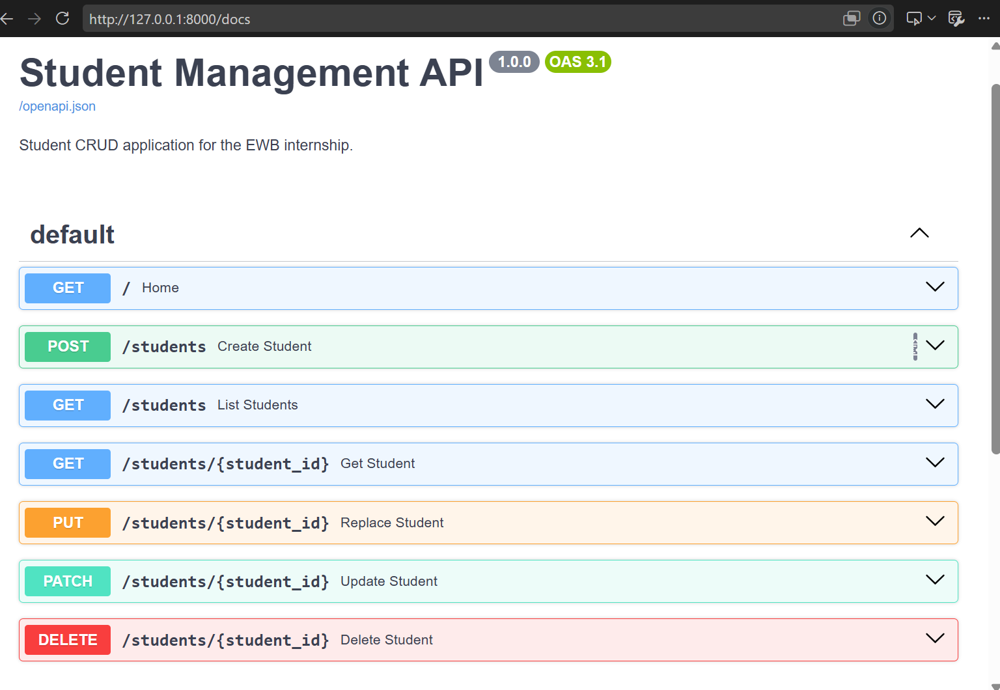
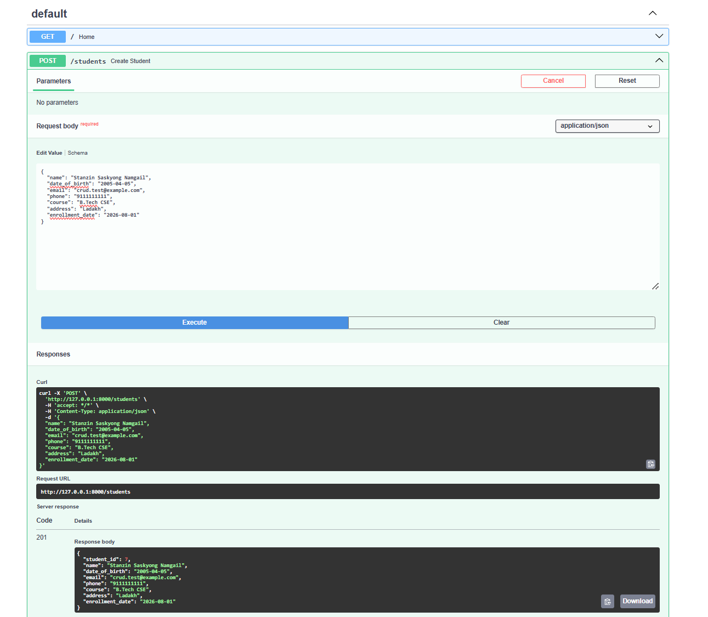
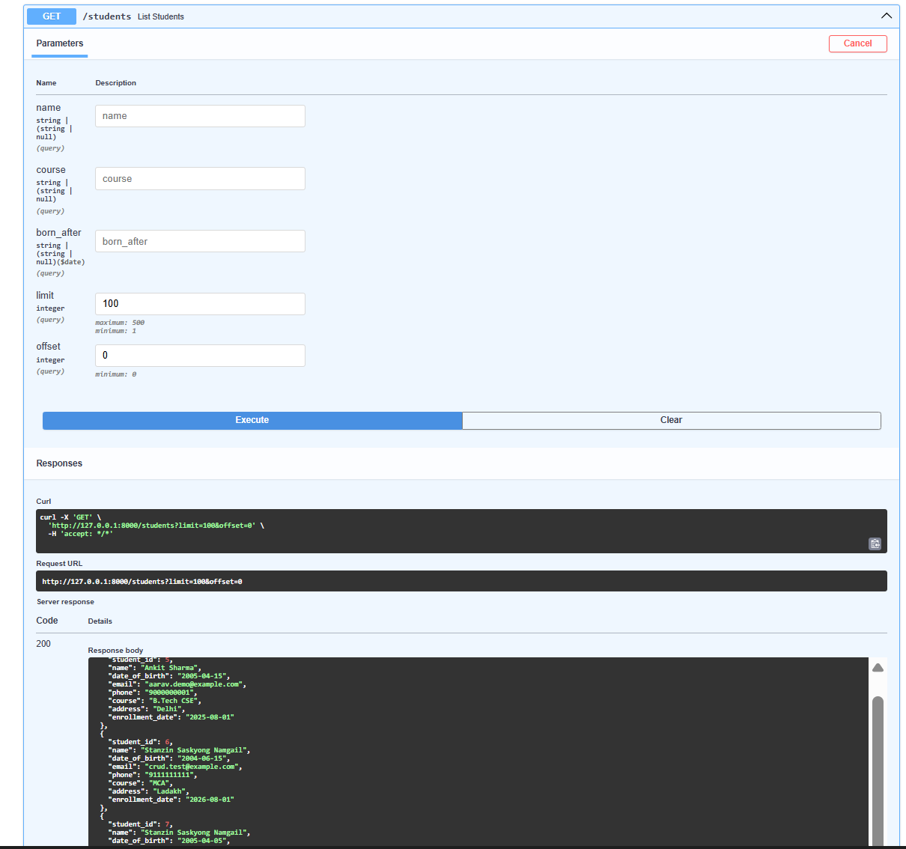
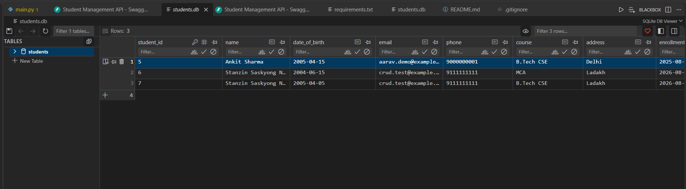
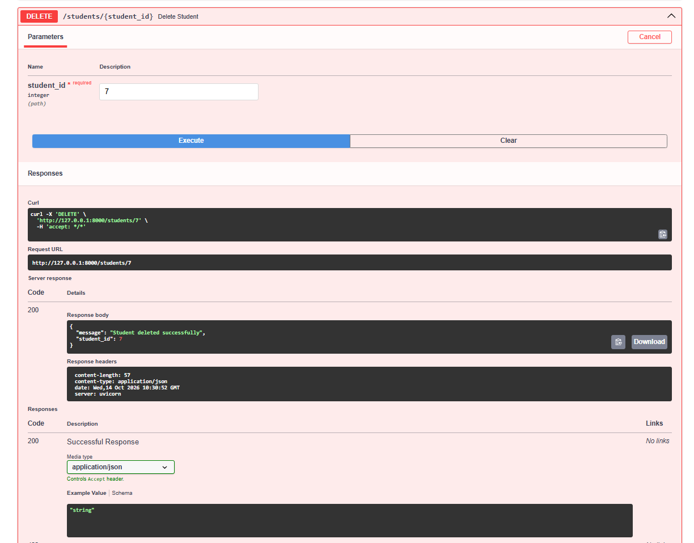

# Student Management CRUD API

**EWB EDU TECH PVT. LTD. — Python Backend Development Internship**

## Project Overview

The Student Management CRUD API is a backend application built using Python, FastAPI, and SQLite. It provides REST API endpoints to create, retrieve, search, update, and delete student records.

## Technologies Used

- Python 3.10+
- FastAPI
- SQLite
- Uvicorn
- Pydantic
- Git and GitHub

## Features

- Create new student records
- Retrieve all students or an individual student by ID
- Filter students by name, course, and date of birth
- Update records using PUT and PATCH
- Delete student records
- Validate input data
- Handle missing student records
- Return appropriate HTTP status codes
- Store records persistently in SQLite
- Interactive API documentation through Swagger UI

## Project Structure

```text
Student-CRUD-Project/
├── main.py
├── requirements.txt
├── README.md
├── .gitignore
└── screenshots/
    ├── swagger-ui.png
    ├── create-student.png
    ├── students-database.png
    ├── get-students.png
    └── update-delete.png
```

**Note:** The `students.db` file is generated automatically when the application starts. It is excluded from Git using `.gitignore` and is not included in the repository.

## Prerequisites

- Python 3.10 or newer
- pip
- Git
- VS Code or another Python editor

## Installation

Clone the repository:

```bash
git clone https://github.com/Saskyong2004
cd Student-CRUD-Project
```

Create a virtual environment:

```bash
python -m venv venv
```

Install dependencies on Windows PowerShell:

```powershell
.\venv\Scripts\python.exe -m pip install -r requirements.txt
```

On Linux or macOS, activate the virtual environment and install dependencies:

```bash
source venv/bin/activate
python -m pip install -r requirements.txt
```

## Run the Application

On Windows PowerShell:

```powershell
.\venv\Scripts\python.exe -m uvicorn main:app --reload
```

On Linux or macOS, with the virtual environment activated:

```bash
uvicorn main:app --reload
```

The application will run locally at `http://127.0.0.1:8000`.

## API Documentation

Run Locally

After starting the server, open:

- **Swagger UI:** http://127.0.0.1:8000/docs
- **ReDoc:** http://127.0.0.1:8000/redoc
- **API Home:** http://127.0.0.1:8000/

Live Demo

Live API: https://student-crud-project-hxwl.onrender.com/

Swagger UI: https://student-crud-project-hxwl.onrender.com/docs

ReDoc Documentation: https://student-crud-project-hxwl.onrender.com/redoc

The API is deployed on Render. The free service may take a little time to respond after a period of inactivity.

## API Endpoints

| Method | Endpoint | Purpose |
|---|---|---|
| POST | `/students` | Create a student |
| GET | `/students` | List and filter students |
| GET | `/students/{student_id}` | Retrieve one student |
| PUT | `/students/{student_id}` | Replace student details |
| PATCH | `/students/{student_id}` | Partially update student details |
| DELETE | `/students/{student_id}` | Delete a student |

The listing endpoint supports optional `name`, `course`, `born_after`, `limit`, and `offset` query parameters.

## Example API Request

Use this JSON body with `POST /students`:

```json
{
  "name": "Aarav Sharma",
  "date_of_birth": "2005-04-15",
  "email": "aarav.demo@example.com",
  "phone": "9000000001",
  "course": "B.Tech CSE",
  "address": "Delhi",
  "enrollment_date": "2025-08-01"
}
```

Dates must use the `YYYY-MM-DD` format. At least an email address or phone number must be provided.

You can test requests and inspect responses through Swagger UI at `/docs`.

## Database

The application uses SQLite to store student records in `students.db`. The database and students table are initialized automatically when the application starts. Records persist across server restarts in the local environment.

## Screenshots

The following screenshots demonstrate the API endpoints, successful operations, and database storage.

### 1. Swagger UI — API Endpoints



### 2. Create Student — Successful Response



### 3. Retrieve Students



### 4. SQLite Database — Stored Records



### 5. Update and Delete Operations



## Testing

CRUD operations have been manually tested through Swagger UI, including record creation, retrieval, updating, deletion, input validation, missing-record handling, and database persistence.

## Security and Privacy

- Use fictional student data for demonstrations.
- Do not commit databases containing personal information.
- Never commit passwords, API keys, credentials, or other secrets.
- Keep local environment files and virtual environments out of Git.

## Future Enhancements

- Authentication and role-based access control
- Improved email validation
- Automated testing using pytest
- Database migrations and reporting
- Optional local AI integration using Ollama

## Author

Developed as an individual Python Backend Development internship project for EWB EDU TECH PVT. LTD.
